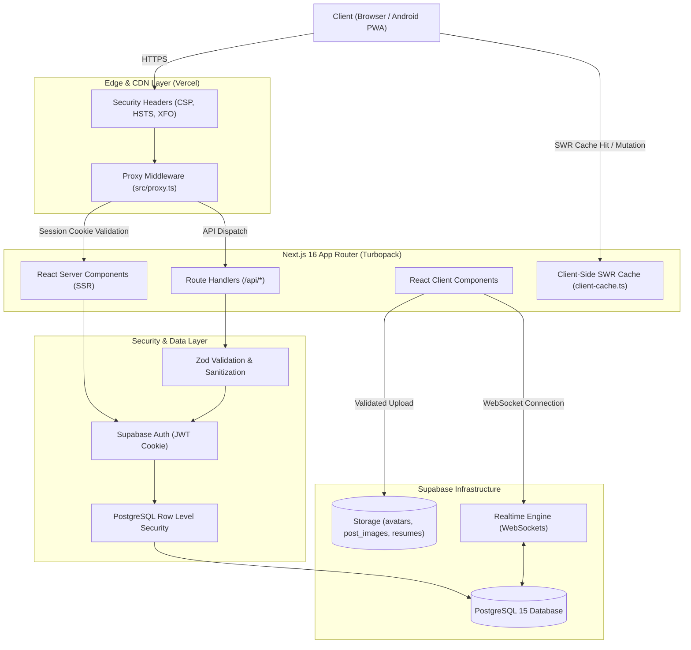
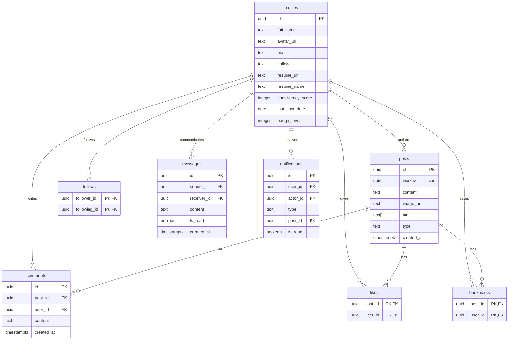

# Trackr — Student Learning & Accountability Platform

<div align="center">
  
  <p><strong>A high-performance, engineering-first social network and productivity platform for students and developers.</strong></p>
  <p>Share daily breakthroughs, build verified consistency streaks, compete in coding arenas, and discover student opportunities.</p>

  [](https://nextjs.org/)
  [](https://react.dev/)
  [-emerald?style=flat-square&logo=supabase)](https://supabase.com/)
  [](https://tailwindcss.com/)
  [](https://www.typescriptlang.org/)
  [](https://trackr-ten-eta.vercel.app/)
</div>

---

## 7.1 Project Overview

**Trackr** is an engineering-first platform engineered specifically for students, competitive programmers, and aspiring engineers. It removes standard social media algorithmic clutter and replaces it with structured accountability:
- **Progress Categorization**: Log daily wins under dedicated progress categories (*Learned*, *Built*, *Practiced*, *Other*).
- **Streak & Consistency Engine**: Build verifiable learning streaks with dynamic badge progression (Bronze, Silver, Gold, Diamond).
- **Opportunities Discovery**: Discover student opportunities across Hackathons, Internships, Scholarships, Competitions, and Open Source fellowships.
- **Direct Real-Time Messaging**: Connect and collaborate with peers through real-time WebSockets and media sharing.
- **Problem Solving & Daily Arena**: Compete on curated daily challenges and track community leaderboard rankings.

Live Production Deployment: [trackr-ten-eta.vercel.app](https://trackr-ten-eta.vercel.app/)

---

## 7.2 Key Features

### Fully Implemented (Production-Ready)
* **Dynamic Feed System**: In-feed tab filtering across *For You*, *Following*, *College*, and *Opportunities* with zero full-page reloads and zero layout shifts.
* **Production Post Composer**:
  - Drag-and-drop / file image uploading with JPG, PNG, WEBP validation ($\le 5\text{MB}$).
  - Real-time `@mention` autocomplete search with streak badges and notification dispatch.
  - Categorized emoji picker with cursor-position insertion.
  - Automatic URL linkification with anti-XSS protection (neutralizing `javascript:` and `data:` schemes).
* **Resume Upload & Portfolio Showcase**: PDF/Word resume uploader ($\le 5\text{MB}$) embedded into the profile header, rendering interactive bio badges.
* **Persistent Layouts & Navigation**: Persistent 3-column layout keeping sidebars and audio/video controls mounted across route navigation.
* **Security Hardening**:
  - Full PostgreSQL Row Level Security (RLS) on all 10 core tables.
  - Comprehensive HTTP Security Headers (CSP, HSTS, X-Frame-Options, Permissions-Policy).
  - Timing-safe administrative secret comparison (`crypto.timingSafeEqual`).
  - Strict file MIME inspection and user storage namespace partitioning.
* **Multi-Tier In-Memory SWR Cache**: Sub-100ms tab transitions with automatic Stale-While-Revalidate and user account isolation.
* **PWA & Offline Capability**: Progressive Web App with service worker caching, Android installation manifests, and offline fallbacks.

### Partially Implemented
* **Opportunities Auto-Sync**: Background syncing engine (`/api/opportunities/sync`) connected to Devpost and external feeds, running on manual/cron invocation.
* **WebRTC Voice/Video Calls**: Signaling implementation (`src/lib/webrtc.ts`) for direct student study calls.

### Planned Features
* **Automated College Verification**: Verification via `.edu` or institutional email domains.
* **Interactive Code Runner**: Embedded Monaco code execution sandboxes inside the Daily Challenges Arena.

---

## 7.3 Technology Stack

| Layer | Technology | Version | Purpose |
|---|---|---|---|
| **Framework** | Next.js (App Router) | `16.2.4` | Server Components, Streaming SSR, Route Handlers, Turbopack |
| **UI Library** | React | `19.2.4` | Modern React Hooks, Suspense boundaries |
| **Language** | TypeScript | `^5.0.0` | Strict type safety across client and server |
| **Styling** | Tailwind CSS | `^4.0.0` | Modern CSS tokens, utility styling, responsive grid |
| **Database & Auth** | Supabase SSR | `@supabase/ssr ^0.10.2` | Persistent 30-day session cookies, PostgreSQL RLS |
| **PostgreSQL Client** | Supabase JS | `@supabase/supabase-js ^2.104.1` | Database interactions, Realtime subscriptions, Storage |
| **Validation** | Zod | `^4.3.6` | Schema validation for API payloads and search queries |
| **Icons & Animation** | Lucide React / Framer Motion | `^1.9.0` / `^12.38.0` | Lightweight SVG icons and fluid micro-interactions |
| **Hosting** | Vercel | Production | Global edge delivery, CDN caching, CI/CD |

---

## 7.4 System Architecture



---

## 7.5 Frontend Architecture

The frontend follows the Next.js 16 App Router convention, utilizing route groups:

* **Persistent Shell Layout (`src/app/(app)/layout.tsx`)**:
  - **Left Sidebar**: Global navigation, streak flame tracker, theme switch, authenticated user profile pill.
  - **Center Viewport**: Dynamic scrollable feed, route view, or message canvas.
  - **Right Sidebar**: Quick search bar, trending topics, verified upcoming hackathons, and the **Most Active** community leaderboard widget.
* **Client vs. Server Components**:
  - Server Components handle server-side data extraction, initial page hydration, and SEO metadata (`/profile/[id]`, `/leaderboard`).
  - Client Components (`'use client'`) manage local state, optimistic mutations, real-time channels, and media handling (`InlinePostComposer`, `Feed`, `Messages`).
* **SWR Client-Side Cache**:
  - `src/lib/cache/client-cache.ts` provides instant 0ms transitions across tabs while revalidating stale content in the background.

---

## 7.6 Backend Architecture

Backend responsibilities are handled via Next.js Route Handlers and Supabase server clients:

* **Route Handlers (`src/app/api/`)**:
  - `/api/opportunities`: Validates search, category, mode, location, and bounded pagination (`limit <= 50`) using Zod. Returns edge-cacheable responses (`Cache-Control: public, s-maxage=300`).
  - `/api/opportunities/bookmark`: Authenticated endpoint managing saved opportunities. Enforces ownership verification via Supabase session.
  - `/api/opportunities/sync`: Administrative synchronization trigger, protected by constant-time token validation.
  - `/api/admin/generate-challenges`: Cryptographically authenticated job creating balanced 30-day coding challenges.
* **Error Sanitization**:
  - All endpoints catch internal exceptions and return standard sanitized JSON errors (`{ error: "Internal server error" }`), preventing database schema or stack trace leakage.

---

## 7.7 Database Architecture

Trackr's relational database consists of 10 core tables with Row Level Security enabled on 100% of tables:



Detailed database schema reference, indexes, and trigger logic: [`docs/DATABASE.md`](docs/DATABASE.md).

---

## 7.8 Authentication & Security

1. **Session Handling**: 30-day persistent session cookies with `sameSite: 'lax'`, `path: '/'`, and `secure: true` in production.
2. **PostgreSQL RLS**: Enforced directly at the database boundary via `auth.uid() = user_id`.
3. **Constant-Time Verification**: Admin secrets are verified with `crypto.timingSafeEqual` in `src/lib/security/api-security.ts`.
4. **File Upload Hardening**:
   - Strictly enforces file sizes $\le 5\text{MB}$.
   - Allowed MIME types: images (`jpeg, png, webp`), resumes (`pdf, doc, docx`).
   - Namespaces all files under `${user.id}-${timestamp}.${ext}` to prevent collision and overwrite attacks.
5. **Content Security Policy (CSP)**: Strict headers deployed in `next.config.ts` preventing XSS, unauthorized framing, and insecure external resources.

Detailed security documentation and threat model: [`docs/SECURITY.md`](docs/SECURITY.md).

---

## 7.9 Caching & Performance Architecture

* **In-Memory Cache (`src/lib/cache/client-cache.ts`)**: Capped at 300 entries with LRU eviction and SWR support.
* **Account Isolation**: Cache entries verify `currentUserId` matching, preventing data leakage between user switches on shared devices.
* **Request Deduplication**: `dedupeFetch` combines concurrent duplicate network calls into a single in-flight Promise.
* **Parallel Server Queries**: Replaces sequential `await` cascades with `Promise.all`.
* **Edge HTTP Caching**: 5-minute CDN caching on public opportunity endpoints.

Detailed performance benchmarks and metrics: [`docs/PERFORMANCE.md`](docs/PERFORMANCE.md).

---

## 7.10 Project Folder Structure

```text
trackr/
├── .env.example                     # Environment template with security instructions
├── next.config.ts                   # Next.js configuration & HTTP security headers
├── package.json                     # Project manifest and verified dependencies
├── tsconfig.json                    # Strict TypeScript configuration
├── supabase_schema.sql              # Complete PostgreSQL schema, RLS, and triggers
├── docs/                            # Comprehensive engineering documentation
│   ├── ARCHITECTURE.md              # System design, data flow, and ADRs
│   ├── SECURITY.md                  # RLS matrix, threat model, and security checklist
│   ├── PERFORMANCE.md               # Caching tiers, DB indexes, and benchmarks
│   └── DATABASE.md                  # Full table schemas and ER diagrams
├── public/                          # Static PWA assets, icons, and illustrations
└── src/
    ├── proxy.ts                     # Edge proxy / session middleware matcher
    ├── app/                         # App Router root
    │   ├── layout.tsx               # Root HTML wrapper and theme initialization
    │   ├── page.tsx                 # Landing / onboarding gateway
    │   ├── (app)/                   # Authenticated application route group
    │   │   ├── layout.tsx           # Persistent 3-column shell layout
    │   │   ├── dashboard/           # Main feed (For You, Following, College, Opps)
    │   │   ├── explore/             # Global student exploration
    │   │   ├── challenges/          # Daily coding challenge arena
    │   │   ├── leaderboard/         # Real-time community consistency leaderboard
    │   │   ├── messages/            # Real-time peer-to-peer messaging
    │   │   ├── notifications/       # Activity feed (likes, mentions, follows)
    │   │   ├── profile/             # Current student profile
    │   │   └── saved/               # Bookmarked posts and resources
    │   ├── api/                     # Serverless Route Handlers
    │   │   ├── admin/generate-challenges/ # Administrative challenge generator
    │   │   └── opportunities/       # Directory & bookmark API endpoints
    │   └── auth/                    # Sign-in, sign-up, and password reset flows
    ├── components/                  # Modular React UI components
    │   ├── dashboard/               # Feed components, inline post composer
    │   ├── layout/                  # Sidebar, right sidebar, navigation drawer
    │   ├── opportunities/           # Opportunity cards and filter controls
    │   ├── profile/                 # Profile dashboard, edit dialog, resume viewer
    │   ├── ui/                      # Base UI primitives (buttons, modals, dialogs)
    │   └── widgets/                 # Trending, upcoming hackathons, who to follow
    └── lib/                         # Shared libraries & utilities
        ├── auth/                    # Server-side auth helpers
        ├── cache/                   # Client-side SWR cache & dedupeFetch
        ├── observability/           # Redacting structured logger & metrics timer
        ├── opportunities/           # Queries and external feed normalization
        ├── security/                # Constant-time crypto & file validation
        ├── supabase/                # SSR client, browser client, server client
        └── utils/                   # Streak calculation, handles, formatting
```

---

## 7.11 Local Development Setup

### 1. Prerequisites
- **Node.js**: `v20.x` or `v22.x` (LTS recommended)
- **Package Manager**: `npm` (v10+)
- **Supabase Account**: A running Supabase project with PostgreSQL 15

### 2. Clone & Install
```bash
git clone https://github.com/samiralam321/NewTrackr.git
cd NewTrackr
npm install
```

### 3. Configure Environment Variables
Copy `.env.example` to `.env.local`:
```bash
cp .env.example .env.local
```
Fill in your Supabase credentials:
```env
NEXT_PUBLIC_SUPABASE_URL=https://your-project.supabase.co
NEXT_PUBLIC_SUPABASE_ANON_KEY=your-anon-key
SUPABASE_SERVICE_ROLE_KEY=your-service-role-key
ADMIN_SECRET_KEY=generate-a-secure-random-token
```

### 4. Database Setup
Execute `supabase_schema.sql` in your Supabase SQL Editor to provision all tables, Row Level Security policies, storage buckets, and triggers.

### 5. Run Development Server
```bash
npm run dev
```
Open [http://localhost:3000](http://localhost:3000) in your browser.

### 6. Build & Validate
```bash
# Run TypeScript compilation check
npx tsc --noEmit

# Run Next.js production build
npm run build
```

---

## 7.12 Deployment Architecture

* **Hosting Platform**: Vercel (Production edge network).
* **Build Command**: `next build` (Turbopack compiler).
* **Environment Configuration**: Set `NEXT_PUBLIC_SUPABASE_URL`, `NEXT_PUBLIC_SUPABASE_ANON_KEY`, `SUPABASE_SERVICE_ROLE_KEY`, and `ADMIN_SECRET_KEY` in Vercel Project Settings.
* **Continuous Integration**: Every push to `main` executes automatic TypeScript validation, production compilation, and zero-downtime deployment.

---

## 7.13 Contribution Guidelines

1. **Branch Naming**:
   - `feat/feature-name` for new functionality.
   - `fix/bug-description` for defect corrections.
   - `perf/optimization` for performance improvements.
   - `docs/documentation-update` for documentation changes.
2. **Code Standards**:
   - Strict TypeScript: No unchecked `any` types.
   - Zero ESLint warnings / errors.
   - Database queries must always respect Row Level Security.
   - Never commit `.env` files or API secrets.
3. **Pull Request Protocol**:
   - All PRs must verify that `npx tsc --noEmit` and `npm run build` exit with code 0 before submission.

---

## 7.14 Future Roadmap

- [ ] **Automated University Verification**: OAuth verification via university email domains (`.edu`, `.ac.in`).
- [ ] **Arena Code Execution**: WebAssembly-powered in-browser code sandbox for competitive programming.
- [ ] **Collaborative Study Rooms**: Real-time multi-peer audio/video study spaces with shared scratchpads.
- [ ] **Native Mobile Releases**: Direct packaging via Capacitor / React Native for Google Play Store.

---

<div align="center">
  <p>© 2026 Trackr. Engineered for students, builders, and continuous learners.</p>
</div>
