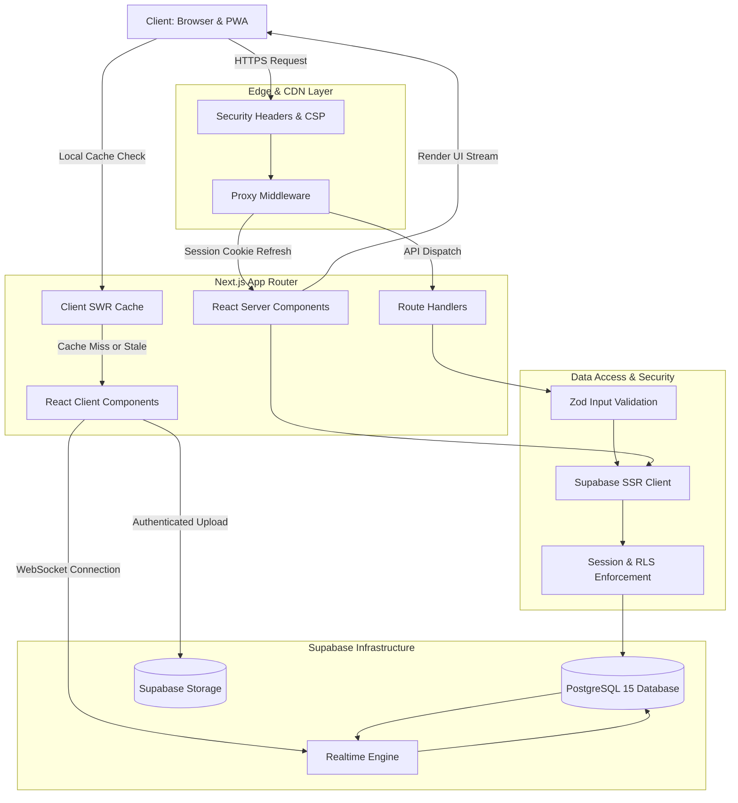

# TRACKR — SYSTEM ARCHITECTURE DOCUMENTATION

## 1. System Overview

**Trackr** is an engineering-first, high-performance social networking and accountability platform tailored for students, developers, and builders. It provides structured progress logging (Learned, Built, Practiced, Other), streak gamification, real-time peer messaging, coding arenas, and real-time opportunity discovery (hackathons, internships, fellowships).

The platform is designed around three architectural pillars:
1. **Zero-Latency Perceived Performance**: Combining Next.js App Router streaming SSR, React Server Components, and client-side memory caching with Stale-While-Revalidate (SWR) guarantees sub-100ms transitions between feeds and profile routes.
2. **Security by Default**: Enforcing authentication and authorization at the database boundary (Supabase PostgreSQL Row Level Security), strict MIME/size file upload validation, constant-time administrative token verification, and defense-in-depth HTTP security headers (CSP, HSTS, frame-ancestors).
3. **Resilient Data Access**: Avoiding N+1 queries through selective column projections, cursor-based and bounded pagination, and optimistic UI state synchronization with rollback guarantees.

---

## 2. End-to-End System Request Flow

---

## 3. Component Boundaries & Responsibilities

| Layer | Responsibility | Key Files |
|---|---|---|
| **Edge Middleware** | Persistent cookie session sync, legacy token sanitation, public route classification, and global security headers | `src/proxy.ts`, `src/lib/supabase/middleware.ts`, `next.config.ts` |
| **Server Components** | Server-side data fetching with zero client JavaScript bundle overhead, metadata generation, and initial state hydration | `src/app/(app)/profile/[id]/page.tsx`, `src/app/(app)/leaderboard/page.tsx` |
| **Client Components** | Interactive widgets, optimistic UI mutations, live tab switching, rich text composer, and audio/video WebRTC peers | `src/components/dashboard/inline-post-composer.tsx`, `src/components/opportunities/opportunities-feed.tsx`, `src/app/(app)/messages/page.tsx` |
| **Data Access Layer** | Typed Supabase client instantiation for Server, Browser, and Service contexts | `src/lib/supabase/server.ts`, `src/lib/supabase/client.ts` |
| **Observability** | Structured log formatting with automated secret/credential redaction and execution time measurement | `src/lib/observability/logger.ts` |
| **Security Utilities** | Constant-time token comparison, MIME file validation, safe external URL checking, and text sanitization | `src/lib/security/api-security.ts` |

---

## 4. Architectural Decisions (ADR)

### ADR 01: Next.js 16 App Router with Persistent Layouts
* **Decision**: Adopt Next.js 16 App Router with route groups `(app)` sharing a persistent three-column layout.
* **Rationale**: Moving between Home, Explore, Challenges, Leaderboard, and Profile preserves mounted navigation sidebars, preventing layout shifts, duplicate avatar queries, and page flicker.

### ADR 02: In-Memory Client Cache with SWR over External Query Client
* **Decision**: Implement a zero-dependency in-memory cache (`src/lib/cache/client-cache.ts`) with user-isolated namespaces and in-flight request deduplication (`dedupeFetch`).
* **Rationale**: Eliminates ~40KB of third-party bundle weight while delivering 0ms tab transitions and deterministic mutation rollbacks.

### ADR 03: PostgreSQL Row-Level Security (RLS) as Primary Authorization
* **Decision**: All authorization checks for user records, posts, bookmarks, likes, follows, and direct messages execute inside PostgreSQL policies via `auth.uid()`.
* **Rationale**: Guarantees defense-in-depth regardless of whether queries originate from Server Components, API routes, or authenticated browser clients.

### ADR 04: Storage Namespace Partitioning by User UUID
* **Decision**: All storage uploads (`post_images`, `avatars`, `resumes`) are prefixed with `${user.id}-${Date.now()}`.
* **Rationale**: Prevents filename collision, namespace squatting, and accidental overwriting across users.
