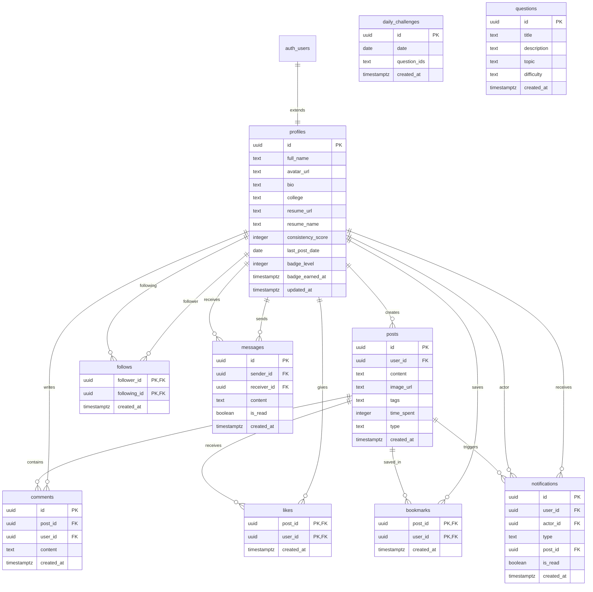

# TRACKR — DATABASE ARCHITECTURE & SCHEMA REFERENCE

## 1. Database Overview

Trackr uses **PostgreSQL 15** hosted on Supabase. The database architecture is built around user profiles connected to learning posts, social interactions (comments, likes, bookmarks, follows), direct messaging, and streak-based gamification triggers.

---

## 2. Entity-Relationship (ER) Diagram

---

## 3. Table Specifications

### 3.1 `profiles`
Represents public student profiles extending Supabase `auth.users`.
- `id` (`uuid`, PK): Foreign key to `auth.users.id` with `on delete cascade`.
- `full_name` (`text`): Display name of the student.
- `avatar_url` (`text`): Public URL to profile avatar stored in `avatars` bucket.
- `bio` (`text`): Short biography or learning goals.
- `college` (`text`): College, university, or organization name.
- `resume_url` (`text`): Direct link to uploaded PDF/Word resume.
- `resume_name` (`text`): Human-readable name of the resume file.
- `consistency_score` (`integer`, default `0`): Current consecutive learning streak.
- `last_post_date` (`date`): Date of the most recent qualifying progress post.
- `badge_level` (`integer`, default `0`): Current streak tier (0=None, 1=Bronze, 2=Silver, 3=Gold, 4=Diamond).
- `badge_earned_at` (`timestamptz`): Timestamp when highest badge tier was attained.

### 3.2 `posts`
Captures progress updates across 4 structured categories.
- `id` (`uuid`, PK): Automatically generated UUID via `gen_random_uuid()`.
- `user_id` (`uuid`, FK): Reference to `profiles.id` with cascade deletion.
- `content` (`text`): Body text, supporting URLs, `@mentions`, and hashtags.
- `image_url` (`text`): Optional image attachment stored in `post_images` bucket.
- `tags` (`text[]`): Array of hashtag strings (e.g. `['#Learned', '#DSA']`).
- `time_spent` (`integer`): Optional minutes spent studying or building.
- `type` (`text`): Constrained to `'Learned'`, `'Built'`, `'Practiced'`, or `'Other'`.
- `created_at` (`timestamptz`): Creation timestamp (UTC).

### 3.3 `comments`
Comments left on progress updates.
- `id` (`uuid`, PK): Primary key UUID.
- `post_id` (`uuid`, FK): Post receiving the comment (`posts.id`).
- `user_id` (`uuid`, FK): Comment author (`profiles.id`).
- `content` (`text`): Comment text.
- `created_at` (`timestamptz`): Timestamp.

### 3.4 `likes`
Compound primary key table for post likes.
- `post_id` (`uuid`, PK, FK): Reference to `posts.id`.
- `user_id` (`uuid`, PK, FK): Reference to `profiles.id`.
- `created_at` (`timestamptz`): Timestamp.

### 3.5 `bookmarks`
Saved posts private to the authenticated user.
- `post_id` (`uuid`, PK, FK): Reference to `posts.id`.
- `user_id` (`uuid`, PK, FK): Reference to `profiles.id`.
- `created_at` (`timestamptz`): Timestamp.

### 3.6 `follows`
Asymmetric student following relationships.
- `follower_id` (`uuid`, PK, FK): The user initiating the follow.
- `following_id` (`uuid`, PK, FK): The target user being followed.
- `created_at` (`timestamptz`): Timestamp.

### 3.7 `messages`
Direct peer-to-peer chat messages.
- `id` (`uuid`, PK): Message UUID.
- `sender_id` (`uuid`, FK): Originating user.
- `receiver_id` (`uuid`, FK): Destination user.
- `content` (`text`): Text or `[IMAGE]: <url>` attachment string.
- `is_read` (`boolean`, default `false`): Read receipt indicator.
- `created_at` (`timestamptz`): Message timestamp.

### 3.8 `notifications`
Real-time activity alerts delivered to users.
- `id` (`uuid`, PK): Notification UUID.
- `user_id` (`uuid`, FK): Recipient of the notification.
- `actor_id` (`uuid`, FK): User who triggered the action.
- `type` (`text`): `'like'`, `'comment'`, `'follow'`, `'mention'`, or `'badge'`.
- `post_id` (`uuid`, FK, optional): Related post if applicable.
- `is_read` (`boolean`, default `false`): Read status.
- `created_at` (`timestamptz`): Timestamp.

---

## 4. Database Triggers & Stored Procedures

1. **`handle_new_user()` on `auth.users` (INSERT)**:
   - Automatically provisions a matching row in `public.profiles` upon user registration with `id`, `full_name`, and `avatar_url` from auth metadata.
2. **`handle_new_like()` on `public.likes` (INSERT)**:
   - Dispatches a notification of type `'like'` to the post owner if the actor is not the author.
3. **`handle_new_comment()` on `public.comments` (INSERT)**:
   - Dispatches a notification of type `'comment'` to the post author.
4. **`handle_new_follow()` on `public.follows` (INSERT)**:
   - Dispatches a notification of type `'follow'` to the user being followed.

---

## 5. Storage Buckets

| Bucket Name | Public Read | Allowed File Types | Size Limit | Purpose |
|---|---|---|---|---|
| `avatars` | Yes | JPG, PNG, WEBP | 5MB | Student profile pictures |
| `post_images` | Yes | JPG, PNG, WEBP | 5MB | Post and chat media attachments |
| `resumes` | Yes | PDF, DOC, DOCX | 5MB | Professional student resumes |
